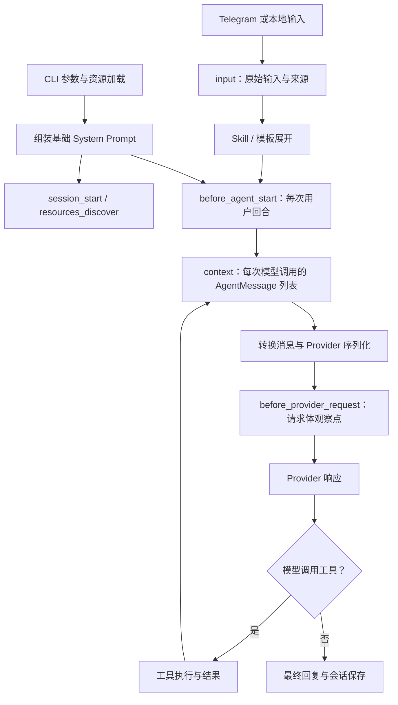

# npm Pi 的上下文接入与观测

本说明以本项目安装的 `@earendil-works/pi-coding-agent@0.84.1` 为准。npm 包提供 Pi 运行时；本项目通过扩展 API、启动参数和项目配置接入能力。安装一个包、把文件放到目录里，并不意味着 Pi 已加载它。

## 当前项目实际加载方式

`start.sh` 固定配置目录为 `.pi/agent/`，会话目录为 `.pi/agent/sessions/`，工作目录为项目根目录。它通过 `-e` 加载 `extensions/telegram/index.ts`（内部加载 Telegram 桥接）、上下文扩展 `extensions/context/index.ts` 及本项目 `extensions/observability/index.ts`；观测扩展最后加载。启动时的项目规则通过 `--append-system-prompt /home/judy/workspace/bot/AGENTS.md` 加入 System Prompt。

| 内容 | 当前接入方式 | 当前状态 |
| --- | --- | --- |
| Pi 默认 System Prompt 与工具说明 | Pi 按当前工具和构建选项组装 | 启用 |
| 项目规则 | `--append-system-prompt` 读取根目录 AGENTS.md | 启用；读取发生在资源加载时；统一加载 AGENTS.md 中的项目约定 |
| Telegram 上下文与工具 | `-e extensions/telegram/index.ts` | 显式加载；连接使用 `/telegram-connect personal` |
| 上下文观测 | `-e extensions/observability/index.ts` | 显式加载，排在其他扩展后面 |
| `extensions/` 中其他参考代码 | 未指定其 `-e` 路径 | 不自动加载 |
| Skills | `--no-skills` 加两个显式 `--skill` | 仅加载项目内 skill-creator 与 web-search |
| Prompt templates | `--no-prompt-templates` | 当前不加载 |
| 自动搜索 AGENTS.md / CLAUDE.md | `--no-context-files` | 当前关闭；项目 AGENTS.md 通过追加参数独立加载 |

`--no-extensions` 关闭自动发现，但不禁止显式 `-e`。多个 `-e` 按顺序注册事件处理器。同一事件中，前一个扩展的修改会传给后一个扩展；新扩展放在观测扩展之前，才能被最终观察点看见。修改启动参数不能使已经运行的 Pi 自动加载新扩展；它需要在保留会话的前提下重新启动。已加载资源的重新读取与新启动参数不是同一件事。

## 一条消息经过哪些阶段



扩展命令先于 `input` 识别，像本地 `/observe` 这样的命令直接执行，不触发模型回合。Telegram 输入由桥接转交 Pi，`input.source` 可能是 `extension`，消息还带有桥接的来源标记；不能只靠这个字段推断所有来源。

一次用户回合可以调用模型多次。`before_agent_start` 每个回合处理 System Prompt 和注入消息；工具结果返回后，会再次经过 `context` 和 Provider 请求观察点。

## 后续组装上下文应该接在哪里

| 需求 | 正式入口 | 影响 |
| --- | --- | --- |
| 固定项目规则 | AGENTS.md + 当前追加参数 | 构建基础 System Prompt；资源重新读取前不会随文件编辑自动更新 |
| 注册工具 | 扩展工厂内 `pi.registerTool()` | 工具可用性、工具说明和模型调用 |
| 修改原始输入 | `pi.on("input", ...)` 返回 `action: "transform"` | Skill / 模板展开前的输入 |
| 为本回合注入规则或记忆 | `before_agent_start` 返回 `systemPrompt` 或 `message` | 链式修改 System Prompt；自定义消息进入会话历史 |
| 为每次模型调用筛选或补充消息 | `context` 返回 `{ messages }` | 当前调用的消息列表；此处修改不自动成为持久会话条目 |
| 修改 Provider 请求体 | `before_provider_request` 返回新 payload | Provider 专用协议层；普通记忆注入应优先用前面的入口 |
| 明确发送新的用户回合 | `pi.sendUserMessage()` | 会触发模型处理，不是单纯追加上下文 |

扩展默认导出工厂函数，参数是 Pi 提供的 `ExtensionAPI`。例如每回合注入项目内记忆的骨架：

```ts
import type { ExtensionAPI } from "@earendil-works/pi-coding-agent";

export default function (pi: ExtensionAPI) {
  pi.on("before_agent_start", event => ({
    systemPrompt: event.systemPrompt + "\n\n" + "这里放本回合已读取的项目内记忆",
  }));
}
```

这是说明接法的例子。项目启动入口现已加载 .pi/extensions/memory/inject/index.ts 和 autosediment/index.ts。真正接入时，读取项目内明确路径，处理缺失或读取失败，再在观测记录中确认变化。避免在扩展工厂里执行昂贵网络请求；工厂先注册能力，需要初始化资源时使用相应会话或任务事件。

`ctx.getSystemPrompt()` 不包含消息列表，也不包含 Provider payload 钩子的修改。`before_agent_start.systemPromptOptions` 能看到构建来源：追加文本、加载的上下文文件、Skills、工具片段等；但基础构建选项不会逐项记录其他扩展后来拼接的文本。因此要同时查看 System Prompt 指纹、`context` 消息结构和 Provider 请求体，不能只打印其中一层就认定模型收到了全部上下文。

## 如何查看

在项目终端执行：

```bash
npm run observe
```

它逐行读取最近的会话观测文件，提取最后一条状态，显示会话文件、模型、显式加载计划、已注册命令、工具、上下文来源、消息结构、请求体摘要、HTTP 状态及最后结果。`processExists` 仅表示该 PID 存在；状态可能是历史记录，结合 `at` 和 `lastStage` 判断。已注册命令与显式加载计划不是所有扩展内部行为的完整清单。

在本地 Pi 执行 `/observe` 可查看当前会话状态与文件路径。这是本地 Pi 命令，不承诺可以直接作为 Telegram 的原生斜杠命令使用。

每个 session 只保留一份观测文件，重启后继续追加；每行是一条 JSON 记录，以 `stage` 区分请求、回复和事件，`requestId` 关联请求与回复：

```text
.pi/agent/observability/<时间>_<session-id>.jsonl
```

同一文件中的普通事件行不保存消息正文、工具参数、工具结果或 HTTP headers；请求和回复行保存正文。普通事件记录输入来源、System Prompt 及追加规则的字符数和指纹、上下文文件路径、Skills、消息角色和块类型、工具耗时、响应 HTTP 状态、模型 usage 与结束原因。`runtimeId` 区分同一 PID 内重新加载的扩展实例，计数属于当前实例；请求带独立 ID，重新加载后继续追加，不覆盖已有记录。字符数不是 Token 数；Token usage 由 Pi 从模型响应归一化，`usage.cost` 则是 Pi 根据模型目录价格的估算，价格可能滞后，不能当成 Provider 的实际账单。

每次经过 `before_provider_request` 都自动保存快照，无需手动开启。一轮对话调用模型多次时，每次分别记录，包括工具结果返回后的请求。`/observe` 查看最近路径；原 `capture` / `cancel` 一次性模式已移除。

请求快照包含 Pi System Prompt、来源摘要、上下文结构和完整 Provider payload（按下文规则脱敏及省略 data URL），并保存模型标识、Pi 版本、时间和当时模型目录单价。回复记录用同一 `requestId` 关联，保存 Pi 输出的 assistant 消息，包括正文、公开的思考块、工具调用、结束原因和归一化用量。工具事件也关联请求 ID。请求有快照而没有回复记录时，不能认定调用完成；进程终止等情况会造成这种状态。

当前 `openai-completions` 适配器在 `buildParams` 之后调用 `onPayload`，随后把返回参数直接交给 OpenAI SDK 的 `chat.completions.create`。本观察点记录的是传给 SDK 的请求对象，不是 HTTP 字节或供应商接收证明；SDK 内部重试可能复用同一对象。其他 Provider 或版本更换后需要重新核对边界。不得从会话历史或回复反推请求内容来替代此记录。

费用使用 Pi 返回的 `usage.cost`，同时保存对应模型目录的每百万 token 美元单价、计算公式和时间作为估算依据，不声称是实时官方价格或账单。当前适配器将缓存命中字段映射到 `cacheRead`，将输入总量减去缓存读取和写入后映射到 `input`。它会把缺失字段填为 0，扩展不能区分“未提供”与“确实为零”：因此 `providerRawUsage` 明确为 null，`cacheFieldPresence` 标记未知；不能将归一化的 0 当作供应商明确报告缓存未命中。直接保留供应商原始 usage 尚未实现。

观测目录被 `.pi/agent/` 的忽略规则覆盖，目录权限 0700、文件权限 0600。快照会含对话正文，作为私有调试资料处理；代码遮盖常见凭据字段和常见 Key/Token 字符串，省略 data URL 内容，但不能保证识别任意自定义秘密格式。不要公开快照或把它作为普通报告提交。

## 边界与验证

观测扩展不返回替换消息或 payload，不调用模型，不额外发 Telegram 消息。磁盘写入失败会提示一次，并让对话继续。事件计数是观察点触发次数，不保证等于 SDK 内部重试的 HTTP 请求次数；也不证明 Telegram 的最终回复送达。其他扩展内部读取的文件和检索结果，若没有进入公开构建选项或消息，就不能由观察器自动还原其来源。

运行 `npm run test:observability` 验证实际安装的 Pi SDK、扩展加载器和事件链：固定规则、System Prompt 注入、自定义消息、`context` 注入、Provider 专用修改、工具回合、会话落盘、普通日志隐私、逐请求快照与回复关联。测试使用模拟模型与临时项目目录，不访问网络或真实 Telegram。桥接原有离线验证仍使用 `npm run test:telegram`。

详细 API 以本地安装包的 [扩展说明](../../node_modules/@earendil-works/pi-coding-agent/docs/extensions.md)、[SDK 接口](../../node_modules/@earendil-works/pi-coding-agent/dist/core/sdk.d.ts) 和 [System Prompt 构建类型](../../node_modules/@earendil-works/pi-coding-agent/dist/core/system-prompt.d.ts) 为依据。Joye 参考探针的 `session_start` 思路用于加载验证；它原来的 HOME 日志路径不适用于本项目，未直接启用。

## 实现记录（2026-10-02）

已切换为逐请求自动记录，移除一次性捕获状态；保留普通日志的正文隔离及写入失败时对话继续的行为。`npm run test:observability` 通过，覆盖多次模型调用、工具结果进入下次请求、快照与回复 ID 对应、权限、凭据遮盖和写入失败隔离；使用本地模拟模型，没有付费请求或 Telegram 测试消息。

运行实例已保留原会话重新启动，状态为 `captureMode: every-request`，Telegram 轮询已恢复。自动记录从本次启用之后的请求开始，不能补回过去未捕获的请求。

文件组织已简化为每个 session 一份 JSONL；原六份事件和状态文件已合并为 14 条历史记录，校验内容一致后移除旧文件。单文件追加、请求与回复关联、权限和失败隔离验证通过。Pi 自己的原生会话文件仍由 Pi 管理。

文件名采用会话创建时间（北京时间 UTC+8，文件名以 +08-00 标明时区）加下划线及 session ID；重启沿用原会话时间，不另建文件。


项目必要约定已统一到根目录 AGENTS.md，由启动入口追加到 System Prompt。运行中的 Pi 不会因文件修改自动更新已加载的 System Prompt；下次 /pi_new 创建运行实例或重新启动时读取新指引。

查询实际请求与回复时，按 [上下文观测查询规则](inspect-model-request-context.md) 定位记录与字段。

## 项目上下文组装入口

`extensions/context/index.ts` 显式加载在 Telegram 后、observability 前。它注册 `before_agent_start` 和 `context`，分别调用 `src/context/system-prompt.ts` 与 `src/context/assemble-messages.ts`。前者处理每个用户回合的完整 System Prompt；后者处理每次模型调用的完整消息列表，包括工具循环后的请求。

System Prompt 当前由 `src/context/system-prompt.ts` 按类别统一组装：保留 Pi/项目/TG 内容后追加记忆类。记忆类内部顺序明确写在 `src/context/memory/system-prompt.ts` 的 `MEMORY_SOURCE_ORDER`：`personal-memory`（静态记忆）→ `session-recap`（摘要规则），不依赖扩展注册先后。未注册来源跳过；未安排类别和顺序的来源注册时抛错，不能静默混入记忆类。后续 skills 等上下文另设类别；当前 Pi 原生 skills 仍由 Pi 生成并属于已有 System Prompt，本次没有迁移 skills。inject/index.ts 将静态文件交给 `registerSystemSource`，将动态召回交给 `registerTurnSource`。`extensions/context/index.ts` 在同一 `before_agent_start` 处理中返回固定系统内容和 `memory-recall` 自定义消息；Pi 按“已有历史 → 当前问题 → 本轮召回 → 模型回答”追加并保存到 session。下一轮不替换或重排旧召回，工具循环也不重复召回。静态文件未改、模型和其他系统来源不变时，System Prompt 保持一致；固定规则更新、模型切换、显式历史编辑或压缩仍可能改变请求前缀。空召回或 CLI 查询失败不生成空消息，保留原有降级行为。最多召回 8 条，静态内容最多 12000 字符，召回块最多 8000 字符（字符上限，不是精确 token 预算）。消息组装原样返回已有消息，尚未实现自定义压缩。autosediment/index.ts 在 agent_end 后先持久保存候选任务，再由 autosediment/tasks.ts 串行筛选、写入和通知，复用 .mem0/config/config.json 的 llm 配置。修改固定规则仍使用 AGENTS.md；后续动态规则与消息组装分别修改上述实现文件。普通请求在后置观测点核对 providerPayload；原生摘要调用的观测缺口仍未补齐。

验证记录：实际 Pi SDK 的上下文观测测试在注入扩展与观测扩展之间加载本模块，验证原有 System Prompt、自定义消息、临时召回样本和工具结果继续到达请求。网络与真实模型调用被禁止。

记忆运行说明：.mem0/memory.md 与 user.md 保存静态内容；Python CLI 对数据库操作加锁，数据使用项目 .mem0。筛选与 mem0 内部模型调用不经过 Pi 普通请求观测点，现由 src/observability/memory.ts 和 memory/mem0/observability.py 追加到同一会话记录；原始用量保存，缺少价格时费用明确未知。真实读写验证使用隔离的临时库，记录保存在 .pi/agent/logs/memory/verification/。任务保存于 `.pi/agent/memory/tasks/<任务 ID>.json`，CLI 写入凭据保存于 `.pi/agent/memory/receipts/<任务 ID>.json`；均为私有数据。任务 ID 根据原 session、用户消息 ID 和候选文本生成，用于重复事件去重。`session_start` 恢复未完成任务，`session_shutdown` 中止本实例操作并释放 worker 锁；不新增服务，也不提供操作系统自动启动。

筛选暂时失败、确认尚未开始写入的失败、通知目标暂不可用，各阶段最多尝试 3 次，重试间隔 5 秒。筛选请求超时为 60 秒，CLI 超时为 120 秒。配置错误停止自动重试；`rejected` 表示模型明确判断不保存，失败不会伪装成该结果。写入中断先查持久凭据：确认完成则不再添加；确认没有开始才允许重试；只有部分 metadata 匹配或结果仍未知时进入 `write_needs_review`，保留任务等待人工核查。通知结果不明进入 `notification_unknown`，不会自动重发。

写入成功与通知成功分别保存；通知失败不会重新写入记忆。恢复任务继续向原 session 的观测文件记录，通知仅在原 session 当前打开时发送。新 session 不接收旧 session 的记忆通知。损坏的任务文件保留并在 stderr 提示，不阻断其他任务；不自动回放此前没有持久任务记录的历史消息。此机制处理进程中断，不承诺断电情况下的恰好一次执行。

记忆自动发现入口 `.pi/extensions/memory/index.ts` 同时注册 inject、autosediment 和 recap。`recap/index.ts` 通过 `registerSystemSource` 提供 `session-recap` 内容，不再单独监听 `before_agent_start` 修改 System Prompt；项目记忆内容统一由 `extensions/context/index.ts` 的监听交给 Pi；动态召回通过该监听返回的 `message` 持久追加，静态记忆和 recap 规则通过 `systemPrompt` 提供。该来源提供 `[Session Recap]` 规则，要求回复末尾提供 `📌 状态… | 下一步…`；`agent_end` 提取该行，没有状态行时使用文本截取兜底，不额外调用模型。摘要按北京时间日期追加至 `.pi/agent/recaps/YYYY-MM-DD.md`，包含时间和来源 session 文件名，供 inject 的近期主题召回读取；不写入 mem0 长期记忆库。


### 动态召回的持久追加

`registerTurnSource()` 是本项目函数，与 `registerSystemSource()` 一样只登记来源。`assembleTurnMessage()` 按记忆类顺序收集本轮资料，返回 `customType: "memory-recall"`、`display: false` 的自定义消息。`before_agent_start` 将该消息交给 Pi 正式接口，Pi 保存为 session 的 custom_message 条目，供应商转换层将其转成 user-role 内容；它属于背景资料，不拥有 System Prompt 的指令优先级。隐藏显示不等于隐藏于模型或观测记录。

动态资料保留本轮的原始分数和顺序，下一轮重新召回只创建新消息；不会更新历史中的同一条记忆。会话恢复保留旧消息，`/pi_new` 创建空白消息历史。压缩仍由 Pi 处理；追加语义保证普通连续回合，不承诺压缩后前缀不变。此前存在于旧 System Prompt 的召回不会反向补入旧历史，也不改写已有观测文件。

查询时，在 `request.providerPayload.input`（Responses）或 `messages` 中查看 `<recalled-memory>`，在原生 session 中查看 `customType: "memory-recall"`。分别比较相邻请求的 `instructions`、旧 `input` 是否完整前缀、工具定义及参数，不仅比较 token 数。静态处理的耗时为 `context.memory.personal-memory`，动态召回为 `context.memory.recall.personal-memory`。

离线验证入口为 `tests/memory/append-only-context.mjs`：使用实际 inject、Pi SDK、Codex 请求序列化、SSE 解析和原有观测层；仅将 CLI 路径、凭据和 HTTP 服务替换为隔离样本。实际请求快照比较覆盖工具循环、不同召回分数、空结果、CLI 失败、会话恢复和新会话。验证记录位于 `.pi/agent/logs/memory/verification/append-only-context-verification.json`，不作为供应商实际缓存命中的证据。
